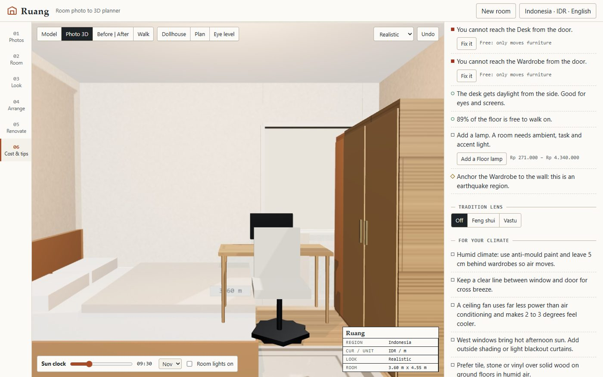

# Ruang

**Photo of your room in, priced 3D plan out.** Ruang turns one phone photo per wall into a 3D room you can
re-style, rearrange and renovate, then prices the plan in your own currency and checks it the way an
architect would (walking space, door swing, sun, light, budget). It runs entirely on your device: no
account, no API key, and your photos never leave it.

Live: https://juw12.github.io/ruang/

## Install it as an app

| Device | How |
|---|---|
| **Windows 10/11 (installer)** | Download `Ruang-<version>-windows-x64-setup.exe` from [Releases](https://github.com/juw12/ruang/releases/latest) and run it. Installs for your user only (no admin), adds a Start-menu entry and an uninstaller. |
| **Windows 10/11 (portable)** | Or take `Ruang-<version>-windows-x64.exe`: one file, no install, run it from anywhere. |
| **Android 7+** | Download `Ruang-<version>-android.apk` from [Releases](https://github.com/juw12/ruang/releases/latest), open it, allow "install unknown apps" for your browser once. Native app (system WebView), works offline. Updates install over the old version because every APK is signed with the same release key. |
| **Android (no download)** | Or open the live link in Chrome -> menu -> **Install app**. |
| **iPhone / iPad** | Open the live link in Safari -> Share -> **Add to Home Screen**. Gets its own icon, full screen, works offline. |
| **Mac / Linux / Chromebook** | Chrome or Edge -> the install icon in the address bar. |

Windows files are not code-signed yet, so SmartScreen may say "Windows protected your PC" -> **More info** ->
**Run anyway**. Check a download against `SHA256SUMS.txt` on the release
(`Get-FileHash .\Ruang-*.exe`). APK signing certificate SHA-256:
`38:7F:69:3C:F8:17:AE:58:E7:F3:F0:CC:35:D3:1F:6B:CA:0F:C9:EB:8A:63:D1:75:6C:77:52:CB:A5:7C:18:E9`
(`apksigner verify --print-certs Ruang-<version>-android.apk`).

The apps are a [Tauri 2](https://tauri.app) shell around the same code (web assets embedded): WebView2 on
Windows, the system WebView on Android. Share links made in the apps point at the public web app so anyone
can open them.

Build it yourself: `python desktop/build.py` -> `desktop/target/release/ruang.exe` (needs Rust + the MSVC
build tools). CI ([.github/workflows/desktop.yml](.github/workflows/desktop.yml)) builds everything on every
`v*` tag and only publishes if all checks pass:

- **Windows:** builds the exe + NSIS installer, drives the real WebView2 window over the DevTools protocol
  (`tests/desktop_smoke.py`), then silently installs, checks the Start-menu shortcut and uninstalls the installer.
- **Android:** builds a universal APK (arm64, armv7, x86_64) with `tauri android build`, signs it with
  `apksigner`, installs it on an Android 14 emulator and checks it launches without a crash and renders
  (`tests/android_smoke.sh`).

## How it works

1. **Region + language first.** 24 regions, 7 UI languages (English, Bahasa Indonesia, 繁體中文, 简体中文,
   日本語, 한국어, Español). Currency, units, climate tips and the sun clock follow the region.
2. **Photos -> 3D.** Drag four corners onto the back wall (or keep the auto guess), enter the ceiling
   height, tap furniture and windows/doors. Ruang reconstructs the room with single-view geometry
   ("Tour into the picture", Horry et al. 1997): the back-wall rectangle plus the image centre as vanishing
   point gives room width, camera height and floor positions. Wall, floor and ceiling colours are sampled
   from the photo. One photo per wall fuses into one room. Optional on-device AI detection (DETR via
   transformers.js) can pre-mark furniture.
3. **Look.** Seven render styles: realistic, miniature (tilt-shift), pixel, cartoon (toon + ink outline),
   clay, blueprint and sketch. Photo-3D mode projects your own photo onto the walls.
4. **Arrange.** Drag, rotate, resize, duplicate, delete, undo/redo, 22 catalogue items. Live warnings for
   overlaps, blocked doors and windows, narrow walkways and door swing.
5. **Renovate.** 18 country/style templates (Japandi, Scandinavian, Javanese joglo, Bali tropical, Korean
   hanok, Mediterranean, industrial loft and more), describe-it-in-words (works in all 7 languages), or
   upload a reference photo and Ruang extracts its palette. Before | after split view.
6. **Cost + tips.** Line-item estimate (paint, floor, furniture, lighting, labour) as a low-high range in
   local currency, every price editable and labelled with its source. Architect notes tied to your layout,
   climate and region, plus design and money tips. Every catch comes with a one-tap fix and its cost:
   free moves (clear a window, turn the desk to side light, re-route a blocked path) or a sourced local
   price (add a floor lamp, curtains for sun glare). CSV, PNG, GLB and share-link export.

## Things no other room app bundles

- **Sun clock + direct-sun hours** – NOAA solar position for your city and date, shadows cast through your
  real window openings, and hours of direct sun per piece of furniture (glare on the TV, fading on the sofa).
- **Walking-space heatmap** – grid flood-fill from the door shows reachable floor and the narrowest
  bottleneck in centimetres.
- **Auto-arrange** – simulated annealing over a layout score (clearances, light, door swing, focal walls).
- **Best look for my money** – a knapsack budget optimiser picks the upgrades with the biggest visual impact
  that fit your budget.
- **Rent-safe mode** – renovation plans that use only removable changes (rugs, lamps, peel-and-stick,
  plants, furniture) for tenants.
- **Will it fit through the door?** – checks a new item's smallest cross-section against your door.
- **Culture lens** – optional feng shui or vastu notes, shown as tradition, not science.
- **Walk mode** – explore at eye height (1.6 m) with WASD or the on-screen pad.

## Where the prices come from

US 2026 installed/retail ranges (Angi cost guides, CostPilotUSA, US flooring guides, FurnFull) are scaled
by the World Bank price-level ratio (WDI PA.NUS.PPPC.RF, 2024) for your region and converted at exchange
rates of 9 Nov 2026. Items without a direct source are marked *proxy*; Taiwan has no World Bank value, so
0.55 is assumed and labelled. These are planning ranges, not quotes – the app says so on every total.

## Limits (honest list)

- Room depth is not visible in a single back-wall photo; Ruang assumes the camera stood 0.4 m inside the
  front wall and lets you edit it. On the bundled sample the default depth is 4.55 m against a true 4.2 m.
- Reconstruction assumes a rectangular room and a level phone; strongly tilted photos give worse sizes.
- AI auto-detect downloads a model from Hugging Face on first use; it could not be tested on the build
  network, so treat it as experimental.

## Run locally

Any static file server works, e.g. `python -m http.server` in this folder, then open
http://localhost:8000/. No build step. three.js r160 is vendored in `vendor/three/` (MIT).

## Tests

`python tests/gates.py` (needs Python + Playwright + Microsoft Edge) runs:
- 49 unit checks (photo reconstruction against a rendered ground-truth room, NOAA sun position, knapsack
  vs brute force, flow BFS, price conversion, architect checks, describe-it parsing in 3 languages),
- i18n key coverage for all 7 languages,
- end-to-end: onboarding -> sample photo -> 3D -> 7 styles render and differ -> drag -> template ->
  describe -> cost in local currency -> share-link round trip -> language switch -> 390 px phone layout.

## License

MIT. three.js is MIT (see `vendor/three/LICENSE`).
